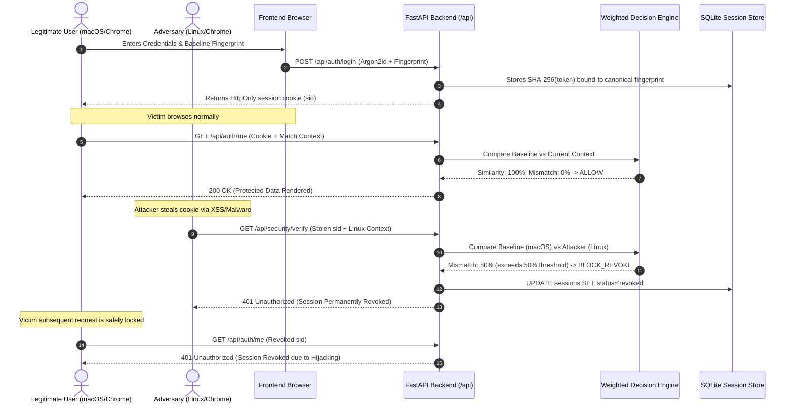

# Behavioral Fingerprint-Based Detection of Session Hijacking in Web Applications

[](https://fastapi.tiangolo.com)
[](https://react.dev)
[](https://tailwindcss.com)
[](https://github.com/P-H-C/phc-winner-argon2)
[](backend/tests)

**Academic Web Security Research & Defense Project**  
*Review - 1 Working Prototype*  

**Project Team:**  
- **Anish Jaiswal** (Reg No: 23BCE0172)  
- **Armaan Budhiraja** (Reg No: 23BCE0507)  

---

## 1. Project Overview

Modern web applications rely almost entirely on bearer session cookies or tokens (e.g. `sid`, `session_token`) stored in client browsers. If an attacker exfiltrates this token—via Cross-Site Scripting (XSS), malicious browser extensions, session sniffing, or local endpoint malware—the attacker can replay the token from any arbitrary remote workstation. Standard application servers validate only whether the token signature exists in memory or storage, remaining completely oblivious to the fact that the physical client hardware and browser runtime have changed.

**SessionDefense** solves this fundamental flaw by continuously evaluating **device context**. 
When a user authenticates, the system non-invasively captures supported browser and hardware characteristics (canvas drawing signature, WebGL unmasked GPU vendor/renderer, screen geometry, CPU hardware concurrency, timezone, and platform OS), normalizes them, and cryptographically binds them to the server-side session.

On subsequent protected requests, the backend **Weighted Comparison Engine** calculates a similarity score ($0.0 - 100.0\%$) and mismatch score. If an attacker attempts to replay a stolen cookie from an anomalous context:
1. The mismatch score exceeds the configured policy threshold ($\ge 50.0\%$).
2. The decision engine issues a `BLOCK_REVOKE` verdict.
3. The server immediately and permanently invalidates the session in SQLite.
4. The client cookies are expunged, locking out both the adversary and the compromised victim session.

---

## 2. Technology Stack

| Layer | Technologies & Libraries |
|---|---|
| **Backend** | Python 3.12, FastAPI, Uvicorn (ASGI), Pydantic v2, SQLAlchemy 2.0 |
| **Authentication & Cryptography** | Argon2id password hashing (`argon2-cffi`), SHA-256 session token hashing, Web Crypto API |
| **Database** | SQLite (via SQLAlchemy ORM), deterministic schema creation |
| **Frontend** | React 19, TypeScript, Vite, Tailwind CSS v4, Lucide React, Recharts |
| **Testing & Verification** | Pytest, Pytest-asyncio, HTTPX TestClient, Oxlint |

---

## 3. Architecture & Security Invariants



### Security Invariants
- **Zero Token Exposure:** Raw bearer tokens are never persisted in the database. The database stores only deterministic SHA-256 hashes of session tokens.
- **Cross-User Isolation:** Users can view and revoke only their own sessions. Session revocation checks ownership before updating the database.
- **Fail-Safe Integrity:** If fewer than 5 comparable browser dimensions are supplied (e.g. fingerprint stripped or spoofed), the engine fails safe to `CHALLENGE`.
- **Explainable Discrepancy:** The decision engine provides human-readable explanations of mismatched attributes without leaking secret cryptographic material.

---

## 4. Prerequisites

- **Python:** 3.11+ (Python 3.12 recommended)
- **Node.js:** 18+ or 20+
- **npm:** 9+ or 10+
- **Operating System:** macOS, Linux, or Windows (WSL2 recommended on Windows)

---

## 5. Quick Installation & Startup

### Step A: Backend Setup

```bash
# Navigate to backend directory
cd backend

# Create Python virtual environment
python3 -m venv venv
source venv/bin/activate

# Install dependencies
pip install -r requirements.txt

# Start FastAPI server
uvicorn app.main:app --host 0.0.0.0 --port 8000 --reload
```

The backend starts at: **http://localhost:8000**  
Interactive API Docs (Swagger): **http://localhost:8000/api/docs**  
API Health Check: **http://localhost:8000/api/health**  

---

### Step B: Frontend Setup

```bash
# Open a new terminal and navigate to frontend directory
cd frontend

# Install node dependencies
npm install

# Start Vite development server
npm run dev
```

The frontend application starts at: **http://localhost:5173**  

---

## 6. Demo Accounts & Credentials

The application includes pre-configured demo credentials for quick evaluation:

| Account Type | Username | Password | Email |
|---|---|---|---|
| **Demo Student** | `student_alice` | `SecurePassword123!` | `alice@university.edu` |
| **Demo Victim** | `demo_victim` | `LegitimateUser2026!` | `demo_victim@session-defense.local` |
| **Evaluator Account** | Quick Registration | Minimum 8 chars | Any valid email |

*(A **"Fill Demo Credentials"** button is provided on the Sign-In page for 1-click credential population).*

---

## 7. Interactive Attack Simulation Lab Walkthrough

The **Attack Simulation Lab** (`/simulation`) demonstrates the exact threat lifecycle without hardcoded results:

1. **Stage 1 — Establish Baseline Session:** Click **"Initialize Legitimate Session"**. A dedicated session is generated, binding your current browser's OS, canvas hash, and timezone to the session token.
2. **Stage 2 — Normal Subsequent Request:** Click **"Execute Legitimate Request"**. The backend comparator evaluates the current browser against the baseline. Result: **100% similarity, ALLOW**.
3. **Stage 3 — Stolen Cookie Replay Attack:** Select an adversary profile (e.g., *Linux Workstation* or *Windows Terminal*). Click **"Replay Stolen Cookie from Attacker Machine"**. The real backend decision engine detects attribute discrepancies (OS changed, canvas signature mismatch, timezone discrepancy), flags a **mismatch score of 70–85%**, issues a **`BLOCK_REVOKE`** decision, and invalidates the session in SQLite.
4. **Stage 4 — Verify Revocation:** Click **"Verify Session Revocation"**. Sends a subsequent request using the stolen token. Confirms that the server rejects the request with an HTTP **401 Unauthorized** error.

---

## 8. Automated Test Suite

Run the full automated test suite covering all 19 security scenarios:

```bash
cd backend
venv/bin/pytest
```

### Test Coverage Highlights
- `test_successful_registration`: Baseline registration & cookie issuance.
- `test_duplicate_registration_prevention`: Rejects duplicate usernames/emails.
- `test_successful_login`: Argon2id password verification and session issuance.
- `test_invalid_credentials_rejected`: 401 response and failed login audit logging.
- `test_successful_protected_me_request`: Verified access to protected endpoints.
- `test_valid_fingerprint_comparison`: 100% similarity on identical browser context.
- `test_mismatched_fingerprint_detection`: Anomaly detection & automatic revocation.
- `test_session_expiration`: Server-side expiration rejection.
- `test_session_revocation`: User-initiated manual session revocation.
- `test_replay_simulation`: Realistic stolen cookie replay test.
- `test_revoked_session_rejection`: Rejection of revoked tokens.
- `test_unauthorized_api_access`: Authentication requirement enforcement.
- `test_cross_user_access_prevention`: Cross-user session tampering isolation (403 Forbidden).
- `test_malformed_fingerprint_input`: 422 Unprocessable Content on invalid payload.
- `test_insufficient_fingerprint_evidence`: Minimum evidence fail-safe policy.
- `test_security_event_creation`: Audit trail integrity and zero token exposure.
- `test_get_system_settings`: Runtime settings inspection.
- `test_update_system_settings`: Threshold validation & policy updates.
- `test_complete_end_to_end_security_demonstration`: Full 11-step end-to-end security lifecycle.

---

## 9. Project Structure

```
session-hijacking-detection/
├── backend/
│   ├── app/
│   │   ├── api/
│   │   │   ├── deps.py              # Session & CSRF verification dependencies
│   │   │   └── routes/
│   │   │       ├── auth.py          # Register, login, logout, /me
│   │   │       ├── demo.py          # Interactive attack lab simulation endpoints
│   │   │       ├── security.py      # Verification, telemetry, events, settings
│   │   │       └── sessions.py      # User session inventory & revocation
│   │   ├── core/
│   │   │   ├── config.py            # Pydantic BaseSettings & weights
│   │   │   └── security.py          # Argon2id, SHA-256 token hashing
│   │   ├── db/
│   │   │   └── session.py           # SQLite connection & sessionmaker
│   │   ├── models/
│   │   │   ├── user.py              # User account model
│   │   │   ├── session.py           # SessionModel with fingerprint & revocation fields
│   │   │   └── security_event.py    # Immutable security audit log model
│   │   ├── schemas/
│   │   │   ├── auth.py              # Auth request/response schemas
│   │   │   ├── fingerprint.py       # Comparison result schemas
│   │   │   ├── session.py           # Session inventory schemas
│   │   │   ├── security_event.py    # Metric & event schemas
│   │   │   └── settings.py          # System settings & update schemas
│   │   ├── services/
│   │   │   ├── auth_service.py      # User registration & Argon2id auth
│   │   │   ├── decision_engine.py   # Weighted fingerprint comparator
│   │   │   ├── fingerprint_service.py # Normalization & canonical hashing
│   │   │   └── session_service.py   # Session creation, lookup, revocation
│   │   └── main.py                  # FastAPI application entrypoint
│   ├── data/
│   │   └── session_security.db      # SQLite database file
│   ├── tests/
│   │   ├── conftest.py              # Test database fixtures & client setup
│   │   └── test_backend.py          # 19 comprehensive automated tests
│   ├── pytest.ini                   # Pytest configuration
│   └── requirements.txt             # Backend dependencies
│
├── frontend/
│   ├── src/
│   │   ├── components/
│   │   │   ├── Header.tsx           # Real system health & user navigation
│   │   │   └── Sidebar.tsx          # Enterprise SOC sidebar navigation
│   │   ├── context/
│   │   │   └── AuthContext.tsx      # Global auth state & fingerprint initialization
│   │   ├── lib/
│   │   │   ├── api.ts               # Typed HTTP client with CSRF & credentials
│   │   │   └── fingerprint.ts       # Canvas, WebGL, Screen, OS attribute collection
│   │   ├── pages/
│   │   │   ├── OverviewPage.tsx     # Executive SOC dashboard & metrics
│   │   │   ├── MonitoringPage.tsx   # Live telemetry & event streaming
│   │   │   ├── SessionManagerPage.tsx # Session inventory & revocation modal
│   │   │   ├── SimulationLabPage.tsx# Interactive 4-stage attack testbed
│   │   │   ├── SecurityEventsPage.tsx # Audit log explorer with JSON inspector
│   │   │   ├── SettingsPage.tsx     # Threshold & weight policy configuration
│   │   │   └── AuthPage.tsx         # Clean sign-in & registration
│   │   ├── types/
│   │   │   └── index.ts             # TypeScript interfaces
│   │   ├── App.tsx                  # Main application shell
│   │   └── index.css                # Enterprise cybersecurity design system
│   ├── package.json
│   ├── tsconfig.json
│   └── vite.config.ts
│
├── docs/
│   ├── HOW_IT_WORKS.md              # Detailed mathematical comparison algorithm
│   ├── ARCHITECTURE.md              # System design, data models, state machine
│   ├── SECURITY_ANALYSIS.md         # Threat model, limitations, counter-measures
│   ├── API_REFERENCE.md             # Complete REST endpoint documentation
│   ├── TESTING.md                   # Automated & manual testing guide
│   └── PROJECT_PRESENTATION.md      # Review-0 presentation slide deck & notes
│
└── scripts/
    ├── run_backend.sh               # Quick backend launcher
    ├── run_frontend.sh              # Quick frontend launcher
    └── run_tests.sh                 # Quick test runner
```

---

## 10. Security Limitations & Academic Scope

1. **Identical Hardware/Browser Clones:** If an attacker operates on the exact same physical machine hardware, identical OS build, GPU, screen resolution, and timezone (e.g. an attacker on the same local network using identical managed university lab computers), fingerprint divergence may be insufficient to surpass the threshold without behavioral timing.
2. **Tor / Canvas Anti-Fingerprinting:** Privacy-hardened browsers (e.g. Tor Browser, Brave with aggressive shields) introduce artificial canvas noise on each render. While this will detect session movement, it may result in elevated false positives unless screen tolerance and canvas noise dampening are configured.
3. **Complementary Defense:** Behavioral fingerprinting is designed as a **defense-in-depth layer** alongside HttpOnly/Secure cookie flags, SameSite strict policies, short session lifespans, and CSP headers—not as a sole replacement for secure session transmission.

---

## 11. Authors & Academic Acknowledgement

Developed for **Review - 0 Academic Evaluation**:
- **Anish Jaiswal** — 23BCE0172
- **Armaan Budhiraja** — 23BCE0507
