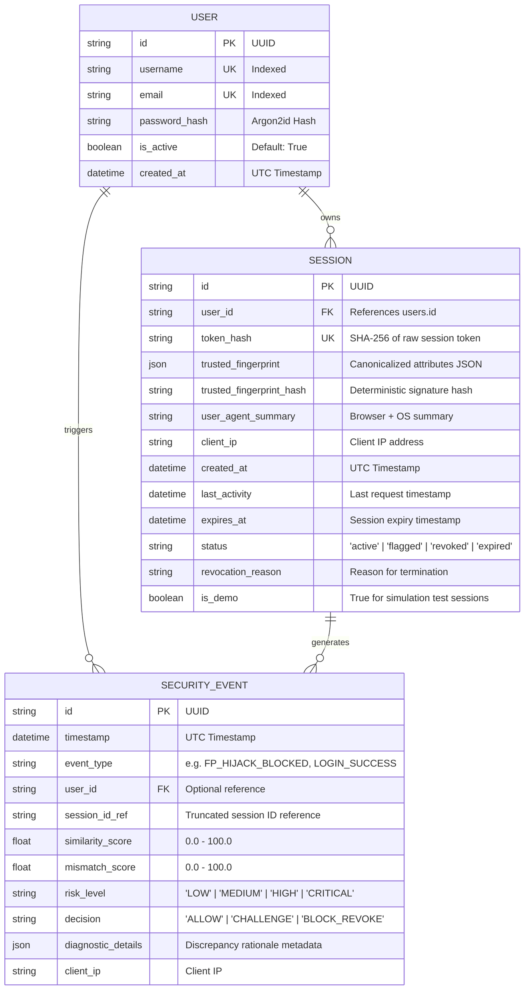

# System Architecture: Behavioral Session Defense

This document details the system components, data schemas, module interactions, and request lifecycle of the **SessionDefense** platform.

---

## 1. High-Level Component Architecture

```
+-----------------------------------------------------------------------------------------+
|                                     Frontend (Client)                                   |
|                                                                                         |
|   +-----------------------+     +------------------------+     +--------------------+   |
|   |  Overview Dashboard   |     |   Live Telemetry Feed  |     | Attack Simulation  |   |
|   |    (OverviewPage)     |     |    (MonitoringPage)    |     | (SimulationLabPage)|   |
|   +-----------------------+     +------------------------+     +--------------------+   |
|   +-----------------------+     +------------------------+     +--------------------+   |
|   |   Session Inventory   |     |   Security Event Log   |     |   Engine Settings  |   |
|   | (SessionManagerPage)  |     |  (SecurityEventsPage)  |     |   (SettingsPage)   |   |
|   +-----------------------+     +------------------------+     +--------------------+   |
|                                                                                         |
|   +---------------------------------------------------------------------------------+   |
|   |  Fingerprint Collector (Web Crypto SHA-256, 2D Canvas, WebGL, Screen, Hardware) |   |
|   |  AuthContext (Session State, Cookie Storage, Automatic Initialization)          |   |
|   |  Typed HTTP Client (Fetch Wrapper, CSRF Header Injection, Credentials)         |   |
|   +---------------------------------------------------------------------------------+   |
+-------------------------------------------|---------------------------------------------+
                                            | HTTP REST API (JSON / Cookies)
+-------------------------------------------v---------------------------------------------+
|                                  FastAPI Backend (Port 8000)                            |
|                                                                                         |
|   +---------------------------------------------------------------------------------+   |
|   | FastAPI ASGI Application & CORS Middleware                                      |   |
|   +---------------------------------------------------------------------------------+   |
|                                                                                         |
|   +-----------------------+     +------------------------+     +--------------------+   |
|   |   Auth Router         |     |   Security Router      |     |  Sessions Router   |   |
|   |   /api/auth/*         |     |   /api/security/*      |     |  /api/sessions/*   |   |
|   +-----------------------+     +------------------------+     +--------------------+   |
|   +-----------------------+     +------------------------+     +--------------------+   |
|   |   Demo Lab Router     |     |   Settings Router      |     |  Health Router     |   |
|   |   /api/demo/*         |     |   /api/security/setting|     |  /api/health       |   |
|   +-----------------------+     +------------------------+     +--------------------+   |
|                                                                                         |
|   +---------------------------------------------------------------------------------+   |
|   | Service Layer:                                                                  |   |
|   | - auth_service: Argon2id verification, user registration                        |   |
|   | - fingerprint_service: Normalization, canonical hashing                         |   |
|   | - decision_engine: Weighted tolerance comparator, risk calculation              |   |
|   | - session_service: SHA-256 token hashing, session lifecycle, revocation        |   |
|   +---------------------------------------------------------------------------------+   |
|                                                                                         |
|   +---------------------------------------------------------------------------------+   |
|   | Data Layer: SQLAlchemy 2.0 ORM -> SQLite Database (session_security.db)          |   |
|   | - users: User accounts and credentials                                          |   |
|   | - sessions: Active & historical sessions bound to JSON fingerprints             |   |
|   | - security_events: Immutable audit log of verifications and attacks             |   |
|   +---------------------------------------------------------------------------------+   |
+-----------------------------------------------------------------------------------------+
```

---

## 2. Database Schema (Entity-Relationship Details)

The database schema is managed via SQLAlchemy 2.0 declarative models and SQLite storage in `backend/data/session_security.db`.



---

## 3. Backend Module Responsibility Matrix

| Module | Location | Primary Responsibilities |
|---|---|---|
| `app.core.config` | `backend/app/core/config.py` | Pydantic `Settings` defining thresholds, cookie flags, weights. |
| `app.core.security` | `backend/app/core/security.py` | Argon2id hashing, cryptographically secure token generation, SHA-256 token hashing. |
| `app.services.fingerprint_service` | `backend/app/services/fingerprint_service.py` | Attribute canonicalization, OS/browser parsing, deterministic signature creation. |
| `app.services.decision_engine` | `backend/app/services/decision_engine.py` | Weighted comparator, screen tolerance checks, minimum evidence policy, risk decisions. |
| `app.services.session_service` | `backend/app/services/session_service.py` | Database session CRUD, token lookup via SHA-256, expiration and revocation logic. |
| `app.api.deps` | `backend/app/api/deps.py` | FastAPI dependencies: extracting session cookie, verifying active status, CSRF verification. |
| `app.api.routes.auth` | `backend/app/api/routes/auth.py` | `/api/auth/register`, `/api/auth/login`, `/api/auth/logout`, `/api/auth/me`. |
| `app.api.routes.security` | `backend/app/api/routes/security.py` | `/api/security/verify`, `/api/security/events`, `/api/security/metrics`, `/api/security/settings`. |
| `app.api.routes.sessions` | `backend/app/api/routes/sessions.py` | `/api/sessions` (list user sessions), `/api/sessions/{id}/revoke`. |
| `app.api.routes.demo` | `backend/app/api/routes/demo.py` | Attack simulation lab endpoints for controlled live demonstrations. |

---

## 4. Frontend Component Architecture

The frontend is structured into an enterprise security operations center (SOC) application:

```
frontend/src/
├── components/
│   ├── Header.tsx        # Top navigation with live API health heartbeat and user controls
│   └── Sidebar.tsx       # Deep navy persistent sidebar navigation with active tab states
├── context/
│   └── AuthContext.tsx   # React Context managing user authentication, local fingerprint, refresh
├── lib/
│   ├── api.ts            # Type-safe API methods sending HttpOnly cookies & CSRF tokens
│   └── fingerprint.ts    # Web Crypto SHA-256, Canvas 2D render hash, WebGL unmasked vendor/renderer
├── pages/
│   ├── OverviewPage.tsx      # Main SOC summary: KPI cards, Recharts score trend, recent events
│   ├── MonitoringPage.tsx    # Live telemetry feed: 5s polling, search filter, scenario breakdown
│   ├── SessionManagerPage.tsx# Table of active/revoked sessions with revocation modal
│   ├── SimulationLabPage.tsx # Multi-stage attack simulator: Legitimate vs Attacker context
│   ├── SecurityEventsPage.tsx# Audit explorer with pagination, risk filters, and JSON inspection
│   ├── SettingsPage.tsx      # Configurable detection thresholds and attribute weights
│   └── AuthPage.tsx          # Clean login & registration with 1-click demo credential filling
├── types/
│   └── index.ts          # Complete TypeScript interfaces for all payloads and models
└── App.tsx               # Root layout assembling Sidebar, Header, and responsive main canvas
```

---

## 5. End-to-End Request Verification Lifecycle

```mermaid
sequenceDiagram
    participant User as Client Browser
    participant Middleware as FastAPI CORS / Session Dep
    participant Comparator as Decision Engine
    participant DB as SQLite Database

    User->>Middleware: HTTP GET /api/auth/me (Cookie: sid=xyz)
    Middleware->>DB: Query Session WHERE token_hash = SHA-256(sid)
    alt Session Not Found or Revoked
        Middleware-->>User: 401 Unauthorized (Session Revoked)
    else Session Active & Valid
        Middleware->>User: Allow protected resource
    end

    User->>Comparator: POST /api/security/verify (Live Fingerprint)
    Comparator->>Comparator: Compare Screen, Platform, Canvas, WebGL, TZ
    alt Mismatch Score >= Revoke Threshold (50%)
        Comparator->>DB: UPDATE Session SET status='revoked'
        Comparator->>DB: INSERT SecurityEvent (FP_HIJACK_BLOCKED)
        Comparator-->>User: Set-Cookie: sid=; Max-Age=0 (200 OK with BLOCK_REVOKE)
    else Mismatch Score < 35%
        Comparator->>DB: INSERT SecurityEvent (FP_VERIFY_SUCCESS)
        Comparator-->>User: 200 OK with ALLOW
    end
```
