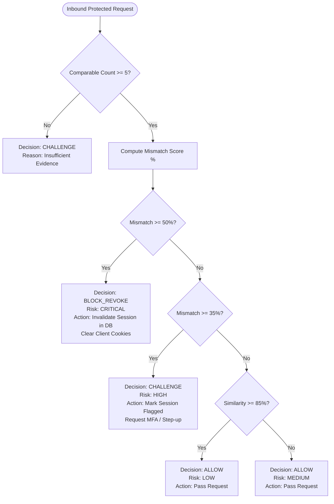

# How It Works: Behavioral Fingerprint-Based Session Hijacking Detection

This document provides a comprehensive mathematical, architectural, and algorithmic explanation of how **SessionDefense** detects and terminates stolen-session cookie replay attacks.

---

## 1. The Threat Context: Session Hijacking via Bearer Cookies

Standard web applications issue a session identifier (e.g., `sid=abc123...`) upon successful credential validation. This cookie is transmitted in subsequent HTTP `Cookie` headers.

The core vulnerability is that session cookies are **bearer tokens**: the application server trusts any request that presents the cookie, regardless of whether the request originated from the legitimate user's laptop or an adversary's remote terminal in another country.

Session tokens can be stolen through:
- **Cross-Site Scripting (XSS):** Script execution exfiltrating cookies from document storage.
- **Malicious Browser Extensions:** High-privilege browser extensions reading active tab cookies.
- **Local Infostealer Malware:** Trojan malware dumping browser SQLite cookie jars (e.g., RedLine, Lumma).
- **Network Interception:** Wi-Fi eavesdropping or proxy manipulation.

Once the token is stolen, the adversary replays it directly in their own browser or curl script. Traditional backends execute the requested action without noticing any anomaly.

---

## 2. Browser Characteristic Collection

During authentication and continuous verification, the client collects supported non-invasive browser and device attributes using standard Web APIs:

```
+-----------------------------------------------------------------------+
|                         Browser Client Context                        |
+-----------------------------------------------------------------------+
| 1. OS & Platform      | navigator.platform ("MacIntel", "Win32", ...) |
| 2. User-Agent Family  | navigator.userAgent (Parsed: Chrome, Firefox) |
| 3. Canvas Signature   | 2D Canvas drawing (geometry + gradient text)  |
| 4. Graphics Hardware  | WebGL UNMASKED_VENDOR & UNMASKED_RENDERER_WEBGL|
| 5. Timezone & Offset  | Intl.DateTimeFormat().resolvedOptions().timeZone|
| 6. Screen Geometry    | screen.width, height, colorDepth, pixelRatio  |
| 7. CPU Concurrency    | navigator.hardwareConcurrency (Core count)    |
| 8. Device RAM Class   | navigator.deviceMemory (Approx. GB)           |
| 9. Primary Language   | navigator.language ("en-US", "zh-CN", ...)    |
+-----------------------------------------------------------------------+
```

### Deterministic Canvas Drawing Signature
Canvas fingerprinting renders off-screen text with distinct anti-aliasing, font smoothing, and composite geometry:
```javascript
const canvas = document.createElement('canvas');
canvas.width = 280; canvas.height = 60;
const ctx = canvas.getContext('2d');
ctx.textBaseline = 'alphabetic';
ctx.font = "14px 'Arial', sans-serif";
ctx.fillStyle = '#f60';
ctx.fillRect(125, 1, 62, 20);
ctx.fillStyle = '#069';
ctx.fillText('SessionDefense⚡2026', 2, 15);
// Convert image buffer to SHA-256 hex string
```
Different GPU hardware, display drivers, sub-pixel rasterizers, and OS font rendering produce slight variations in the pixel buffer, resulting in unique cryptographic hashes across disparate devices.

---

## 3. Server-Side Normalization & Canonical Hashing

Raw browser strings can be brittle (e.g., minor browser version increments `121.0.1` vs `121.0.2`). The backend normalizes attributes into structured canonical formats:

1. **User-Agent:** Parsed to high-level engine/family (`Chrome`, `Firefox`, `Safari`, `Edge`).
2. **OS Platform:** Cross-checked between `navigator.platform` and User-Agent hints (`macOS`, `Windows`, `Linux`, `iOS`, `Android`).
3. **Language:** Stripped to primary language code (e.g., `en-US` -> `en`).
4. **Timezone:** Standardized IANA string (e.g., `America/New_York`, `Europe/Berlin`).
5. **Canvas Hash:** Lowercased SHA-256 hex string.

### Canonical Fingerprint Signature
To verify baseline integrity, stable keys are sorted and hashed:
$$\text{Signature} = \text{SHA-256}\left(\text{JSON.stringify}(\text{sorted canonical fields})\right)$$

---

## 4. The Weighted Comparison Algorithm

When a request arrives at `/api/security/verify` or protected resources, the backend decision engine compares the **Trusted Baseline Fingerprint** ($F_{\text{trusted}}$) against the **Current Request Fingerprint** ($F_{\text{current}}$).

### Attribute Weights
Each dimension is assigned a weight $w_i$ based on hardware stability and difficulty of remote spoofing:

| Attribute ($i$) | Weight ($w_i$) | Category | Description |
|---|---|---|---|
| `platform` | **25.0** | Operating System | Host OS family |
| `canvas_hash` | **25.0** | Hardware / Rendering | Deterministic 2D canvas hash |
| `user_agent_family` | **20.0** | Browser Engine | Major browser engine family |
| `webgl_renderer` | **15.0** | Graphics Hardware | GPU unmasked renderer |
| `timezone` | **15.0** | Localization | IANA timezone name & offset |
| `hardware_concurrency` | **10.0** | CPU Hardware | Number of logical processor cores |
| `language` | **10.0** | Localization | Primary system/browser language |
| `screen` | **10.0** | Display Geometry | Screen resolution with tolerances |
| `device_memory` | **8.0** | Hardware | Device RAM class in GB |
| `webgl_vendor` | **8.0** | Graphics Hardware | GPU vendor string |

### Screen Dimension Tolerances
Screen size can change when an external monitor is connected or detached. To prevent false positives, screen comparison permits a $\pm 20\%$ variance in width/height, but flags strict mismatches in color depth:
$$\Delta w = \frac{|w_{\text{exp}} - w_{\text{act}}|}{w_{\text{exp}}}, \quad \Delta h = \frac{|h_{\text{exp}} - h_{\text{act}}|}{h_{\text{exp}}}$$
If $\Delta w > 0.20$ or $\Delta h > 0.20$, the screen attribute is marked as mismatched.

### Mathematical Formulation of Mismatch & Similarity
Let $C$ be the set of attributes present in both baseline and current request:
$$\text{Total Comparable Weight} = W_{\text{comp}} = \sum_{i \in C} w_i$$
Let $M \subseteq C$ be the subset of attributes where $F_{\text{trusted}}[i] \neq F_{\text{current}}[i]$:
$$\text{Total Mismatched Weight} = W_{\text{mismatch}} = \sum_{j \in M} w_j$$

The **Mismatch Score** ($S_{\text{mismatch}}$) is calculated as:
$$S_{\text{mismatch}} = 100 \times \left( \frac{W_{\text{mismatch}}}{W_{\text{comp}}} \right)$$

The **Similarity Score** ($S_{\text{sim}}$) is:
$$S_{\text{sim}} = 100.0 - S_{\text{mismatch}}$$

---

## 5. Decision Engine State Machine

The decision engine evaluates the mismatch score against configured policy thresholds:



### Policy Thresholds:
- **`MISMATCH_REVOKE_THRESHOLD` (50.0%):** Immediate session termination. The session status is set to `revoked`, the revocation reason is written to the audit log, and client cookies are deleted.
- **`MISMATCH_FLAG_THRESHOLD` (35.0%):** Suspicious anomaly detected. The session status is set to `flagged`, prompting a step-up challenge.
- **`MIN_EVIDENCE_COUNT` (5 attributes):** Fail-safe policy. If an attacker disables JavaScript APIs or strips attributes to evade comparison, the engine treats insufficient evidence as high-risk `CHALLENGE`.

---

## 6. Server-Side Revocation Mechanics

When a session is revoked:
1. `sessions.status` is updated to `'revoked'` in SQLite.
2. `sessions.revocation_reason` records the triggering mismatch score and timestamp.
3. A `SecurityEvent` of type `FP_HIJACK_BLOCKED` or `REPLAY_ATTACK_SIMULATED` is inserted.
4. Response headers emit `Set-Cookie: sid=; Max-Age=0; Path=/` to instruct the client to purge the cookie.
5. Any subsequent HTTP request presenting this session token is rejected by `get_current_session` with an HTTP **401 Unauthorized** response.
